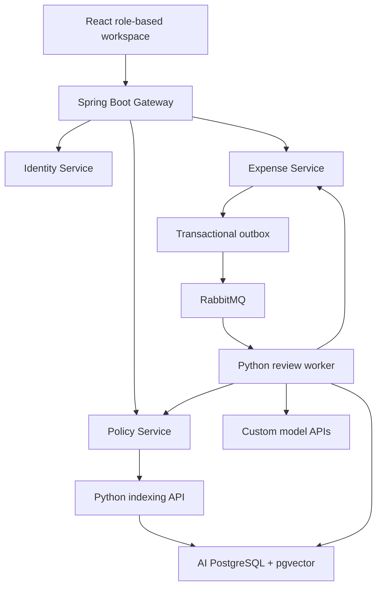
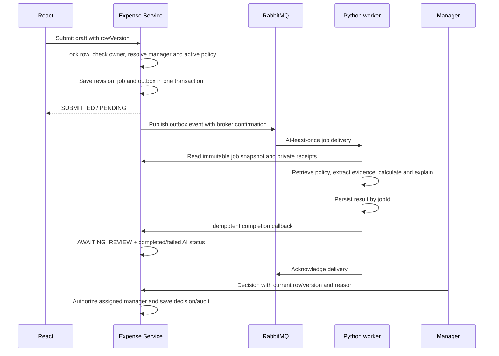

# High-level design

## System boundary

TripLedger manages expense submissions, evidence, AI recommendations and human
review decisions for one organization. It does not transfer money. Employee and
manager identities come from the Identity Service, not form fields supplied by a
browser. All business decisions are recorded by the Expense Service.

## Responsibilities and ownership

| Component | Owns | Does not own |
|---|---|---|
| Identity | Accounts, password hashes, hashed sessions, manager assignments, account audit | Expense decisions |
| Expense | Reports, receipt bytes, immutable revisions, decisions, review job references, outbox and report audit | Passwords, policy indexing |
| Policy | Immutable policy content/rules, publication state, publication audit | Expense ownership |
| Python AI | Policy chunks/embeddings, persisted review outputs, FX cache, provider calls | Human approvals or report mutations except authenticated job callbacks |
| Gateway | Allowlisted routing, login throttling, request correlation | Domain data |
| React | Forms, role-specific views, current browser session | Authorization or monetary authority |

Four independent databases can share one PostgreSQL server. Default local credentials
are shared for ease of setup; production should give each service its own restricted
login. There are no cross-database foreign keys or direct cross-service table writes.
Receipt bytes live in the Expense database to make local operation self-contained.

## Submission sequence

## Business state versus processing state

Business state: DRAFT → SUBMITTED → AWAITING_REVIEW → APPROVED / REJECTED /
CLARIFICATION. Clarification can be edited by the owner and resubmitted as a new
revision. AI state is independent: NONE / PENDING / RUNNING / COMPLETED / FAILED.
A failure still leads to AWAITING_REVIEW, allowing a human decision or an explicit
AI retry. A retry creates a new job for the same immutable revision.

## Policy lifecycle

Drafts are immutable once created; changes create another version. Publication first
indexes the full content and structured rules. Only after indexing succeeds does a
transaction archive the previous active policy and activate the new version. A
partial embedding failure leaves the active policy unchanged. Concurrent publications
are serialized by a database lock; a unique partial index enforces one active version.
Submissions pin policy IDs. Archived versions remain available for old reviews.

## AI trust boundary

The LLM receives untrusted report and receipt text as evidence. Read-only tools expose
only the current report, extracted receipt evidence, deterministic checks and scoped
policy search. It cannot change users, write reports, approve, pay or send messages.
Tools have an allowlist and validated argument shapes. A maximum of six chat steps
bounds agent iteration. Final output is schema-validated, and citation identifiers
must exist in retrieved policy passages. The model supplies an explanation, never
the numeric totals or final business decision.

Deterministic checks use structured rules, not arbitrary instructions in policy prose.
The admin must keep the rules consistent with the text. Unknown categories, missing
policy facts, uncertain receipts and unavailable external reconciliation require
manager judgment. All successful AI runs recommend MANAGER_REVIEW in this release.

## Authentication and authorization

Sessions are cryptographically random opaque bearer tokens, valid for eight hours.
Only SHA-256 token hashes are stored. Java services introspect the token with Identity
on each request, so disabling an account or changing its role revokes access immediately.
Passwords use BCrypt. There is no public registration; admins provision users.

Browser sessions use sessionStorage, not persistent localStorage. They are sent via
Authorization headers, so no authentication cookies or cookie-based CSRF dependency
exists. Treat XSS prevention and TLS as mandatory for deployment. React escapes normal
rendered text; user content is not inserted as raw HTML.

Every report and receipt request checks ownership or assigned-manager scope. Admins
can inspect/reassign, but cannot bypass the manager-only decision endpoint. Managers
cannot decide their own reports. Internal endpoints require SERVICE_KEY and are not
routed by the public gateway. Network isolation remains necessary beyond localhost.

## Reliability and scaling

The Expense Service uses a transactional outbox and publisher confirmations. A broker
outage leaves events pending. Duplicate delivery uses a Python database advisory lock
and a persisted jobId result. Callbacks are idempotent, and stale callbacks cannot
replace the current report job. Worker processes can be scaled independently; each
consumes one message at a time. Broker heartbeat is disabled for long synchronous
provider calls; production should add a heartbeat-capable consumer architecture and
metrics for stuck jobs. There is no claim of exactly-once external provider calls.

The gateway uses fixed configured service URLs rather than discovery/Eureka. This is
suitable for the supplied local deployment and stable container/Kubernetes service
DNS later. Receipt storage and recent-report listing are intentionally bounded; object
storage and cursor pagination are the next scaling extensions.
